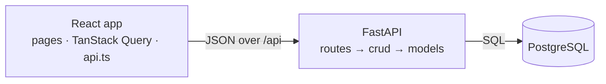

# To-Do App

A full-stack to-do list: sign in, add, tick, search, reorder by drag and drop, and edit tasks on their own screen. React + TypeScript frontend, FastAPI backend, PostgreSQL. Built test-first.

**Demo account:** `demo@example.com` / `demo-password` (created automatically, with four tasks).

## Run it on a Mac

**With Docker** ([Docker Desktop](https://www.docker.com/products/docker-desktop/)):

```bash
docker compose up --build
```

Open http://localhost:8000. One container serves the app and the API; Postgres runs beside it.

**Without Docker** (uses SQLite; needs Node 24.15+, 22.22+ or 26+):

```bash
brew install uv node
./run.sh
```

Open http://localhost:5173. Ctrl+C stops everything.

**Tests:**

```bash
cd backend && uv run pytest --cov=app        # 52 tests
cd ../frontend && npm ci && npm test         # 76 tests
```

## Summary

### Approach

- **Test-driven.** Each feature started as failing tests, committed first (`test:`), then the code that passed them (`feat:`). Bugs found later got a failing test before the fix. `git log` shows the sequence.
- **A small, layered API.** `routes.py` handles HTTP, `crud.py` the data and rules, `models.py` the tables. Pydantic validates every request; every failure returns one JSON shape with a stable code. Validation errors are 400; another user's task is 404, so ids can't be probed.
- **Secure sessions.** Passwords hashed with Argon2id. Sign-in issues a random token, stored only as a SHA-256 hash, valid 7 days; sign-out deletes it.
- **Async through one abstraction.** TanStack Query owns every request: caching, retries of only the failures worth retrying, and task changes queued in click order. Ticking, deleting and reordering show at once and roll back with the server's message if it refuses. Offline, timeouts and server errors each get a clear message.
- **Functional and declarative.** Pure, immutable helpers (`tasks.ts`: `toSorted`, `toSpliced`, a search filter made by a higher-order function); every optimistic change is one hook that takes an update function. Components describe the screen from state.
- **Responsive and accessible.** Pico CSS, labelled controls, 44 px tap targets, and drag and drop by mouse, touch or keyboard (with screen-reader announcements).
- **Easy to run anywhere.** A stateless API on Postgres, one Docker image, and CI on every push.



### Features completed

- [x] Sign in from the landing page, or create an account
- [x] See your tasks after signing in; only your own
- [x] Reorder by drag and drop (mouse, touch, keyboard)
- [x] Search, ignoring case and accents
- [x] Open a task to view or edit it on its own screen
- [x] Create, update, tick off and delete tasks
- [x] Demo account, health check, Docker image, CI

### With more time

| Feature | Estimate |
|---|---|
| Due dates and reminders (reminders need a background worker) | 1 day |
| Filters (all / active / done), with the search kept in the URL | 1.5 h |
| Undo after deleting | 1 h |
| A live deployment on Azure, and Kubernetes manifests tested on a local cluster | 5 h |
| Password reset and email confirmation | 1 day |

### To make it more robust

| Change | Why | Estimate |
|---|---|---|
| Version column with `If-Match` → 412 | Two devices editing one task: today the last save wins | 2 h |
| Alembic migrations as a deploy step | `create_all` can't change existing tables | 2 h |
| Rate limiting on sign-in | Password guessing; Argon2 is memory-heavy under a flood | 2 h |
| httpOnly cookie sessions, CSRF protection, a Content Security Policy | Keeps tokens out of JavaScript's reach | 3 h |
| Keyset pagination | Lists of thousands of tasks | 2 h |
| Structured logs with request ids | Tracing a request across many copies | 1 h |

## API

All under `/api` (interactive docs at http://localhost:8000/docs). Task routes need `Authorization: Bearer <token>`.

- `POST /users`, `POST /sessions`, `DELETE /sessions/current`: sign up, sign in, sign out
- `GET /tasks`, `POST /tasks`, `GET /tasks/{id}`, `PATCH /tasks/{id}`, `DELETE /tasks/{id}`: task CRUD (PATCH also ticks and reorders)
- `GET /health`: 200, or 503 when the database is unreachable

Errors are always `{"error": {"code": "…", "message": "…"}}` (plus `fields` for validation): 400 validation, 401 not signed in, 404 not found, 409 email taken.

## Testing

- **Backend:** 52 pytest tests through the real HTTP stack, on SQLite and on Postgres. Coverage 98%.
- **Frontend:** 76 tests with Vitest (Jest's API), Testing Library and Mock Service Worker, driving the app the way a person does. Coverage 97%.
- **Edge cases:** 32, each pinned by a named test. Bugs found in a real browser or by an independent review each got a failing test before the fix.
- **CI** (GitHub Actions) runs lint, types, both suites on both databases, and a Docker smoke test on every push.

<details>
<summary>The 32 edge cases</summary>

| # | Case | Behaviour |
|---|---|---|
| E1–E2 | Email with capitals or spaces; already registered | Normalized; 409 `EMAIL_TAKEN` |
| E3–E4 | Invalid input; body that isn't JSON | 400 with a message per field |
| E5 | Wrong password or unknown email | The same 401 for both |
| E6–E7 | Missing or expired token; sign out on one device | 401; only that session ends |
| E8–E9 | Unknown URL or method; a crash | Same error shape; no internals leaked |
| E10–E15 | Blank or long text; another user's task; bad id; `null` or unknown fields; empty PATCH; SQL-looking text | 400 / 404 / unchanged / stored literally |
| E16–E17 | Offline, timeout, or a non-JSON error page | Clear messages, never a crash |
| E18–E20 | Expired saved session; corrupt storage; a screen crash | Back to sign-in; still works; "Something went wrong" + Reload |
| E21–E23 | Double-click Add; only spaces; HTML-looking text | One task; button disabled; shown literally |
| E24–E26 | Server refuses a change; two quick moves; switching accounts | Rolled back with the reason; both kept; no stale tasks |
| E27–E29 | Accents in search; dragging while searching; task deleted elsewhere | Matched; handles hidden; "Task not found" |
| E30–E32 | Deep-link refresh in Docker; database down; seeding twice | App loads; 503 health; one demo user |

</details>

## Deploying to the cloud

The API is stateless (sessions live in Postgres, settings come from environment variables), so the same image scales out by running more copies behind a load balancer that checks `/api/health`. On Azure:

- **Azure Container Apps:** the image as 2+ replicas across availability zones, autoscaled, with a readiness probe on `/api/health`
- **Azure Database for PostgreSQL (Flexible Server):** a zone-redundant standby and point-in-time backups
- **Azure Front Door:** a CDN for the built files (hashed names, cached a year) and TLS
- **Azure Key Vault:** `DATABASE_URL`, never baked into the image

<details>
<summary>Azure CLI steps</summary>

```bash
az group create --name todo-rg --location westeurope
az acr create --resource-group todo-rg --name <registry> --sku Basic
az acr build --registry <registry> --image todo-app:1 .

az postgres flexible-server create --resource-group todo-rg --name <db-server> \
  --tier GeneralPurpose --sku-name Standard_D2ds_v5 --high-availability ZoneRedundant \
  --admin-user todo --admin-password '<strong password>' --database-name todo

az containerapp env create --resource-group todo-rg --name todo-env --location westeurope
az containerapp create --resource-group todo-rg --name todo-app --environment todo-env \
  --image <registry>.azurecr.io/todo-app:1 --registry-server <registry>.azurecr.io --registry-identity system \
  --target-port 8000 --ingress external --min-replicas 2 --max-replicas 10 \
  --secrets database-url='postgresql+psycopg://todo:<password>@<db-server>.postgres.database.azure.com:5432/todo?sslmode=require' \
  --env-vars DATABASE_URL=secretref:database-url
```

Then put the app and the database in one virtual network, point the readiness probe at `/api/health`, and move the secret into Key Vault. These steps weren't run against a live subscription; the image and health checks they rely on are tested.

</details>

## Project structure

```
backend/app/     FastAPI: routes, schemas, crud, models, security, errors
backend/tests/   pytest
frontend/src/    React: pages, components, queries.ts (TanStack Query), api.ts, tasks.ts
Dockerfile, docker-compose.yml, run.sh, .github/workflows/ci.yml
```

## AI assistance

Built with Claude Code (Anthropic's AI coding assistant) as a pair programmer. I directed the scope, the features, the edge cases and the test-first workflow; every change landed with its tests and was checked in a real browser, and I can walk through any file.
